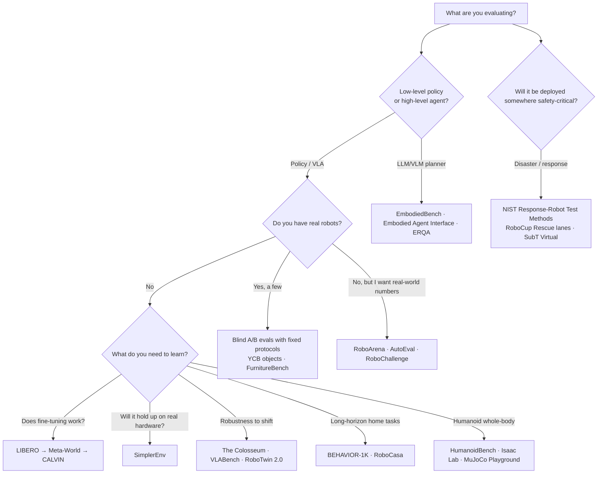

# 🧭 Which robot eval should I use?

A practical guide to choosing evals for robot policies and embodied agents. Each benchmark name links to its entry in the [Atlas](../README.md).

## Rules of thumb

1. **Report the protocol along with the number.** That means trials per task, seeds, training data (the original or a filtered version), which camera views and proprioception the policy got, and the checkpoint you picked. The same model on LIBERO is reported anywhere from 86.0% to 94.2% depending on these choices. See [methodology](methodology.md).
2. **Don't stop at a saturated benchmark.** Top LIBERO averages are now above 95%, so differences there mostly measure recipe, not capability. Add at least one robustness or long-horizon benchmark.
3. **Real-to-sim beats sim-only for generalist policies.** SimplerEnv was built specifically to correlate with real-robot rankings.
4. **For real robots, run blind, randomized A/B tests.** [TRI's LBM study](https://arxiv.org/abs/2507.05331) and [RoboArena](https://robo-arena.github.io/) show how. Report confidence intervals, not single success rates.
5. **For planners, separate reasoning errors from execution errors.** The Embodied Agent Interface gives you an error taxonomy for this.
6. **For safety-critical robots, a standard test method beats a leaderboard.** Responders and procurement officers already know NIST/ASTM response-robot tests. Use them, and publish your repeatability numbers.

## Pitfalls we see often

| Pitfall | Why it misleads | Fix |
|---|---|---|
| Comparing numbers copied from different papers | Different data filtering, trial counts and inputs | Re-run baselines under your own protocol, or compare only within a single source table |
| Picking the best checkpoint by test success | That's test-set leakage | Hold out a validation suite |
| Reporting 10 trials per task | The ±CI is often wider than the gap you're claiming | Run ≥50 trials, or report Wilson intervals |
| Reporting sim-only numbers for a real-world claim | Sim-to-real gaps are large and vary by model | Add SimplerEnv or a real-robot arena |
| Ignoring latency | A model that's great at 1 Hz can be useless for dynamic tasks | Report control frequency and inference hardware |
